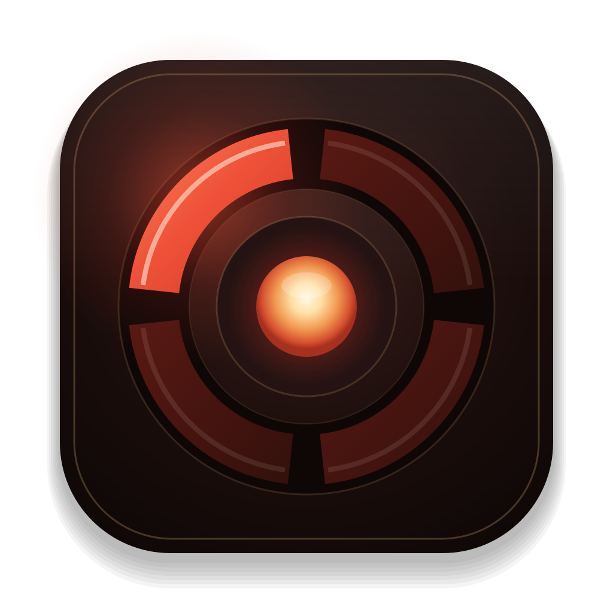

# Valhalla

A free Mac and Windows app for RGH and JTAG Xbox 360 consoles, made by SafeLight.Dev. It keeps your game library in order and gets games, saves and Valkyrie onto your consoles.

## Download

Valhalla 1.8 (26), October 27, 2026

- Mac, macOS 14 or later: [Valhalla.dmg](https://downloads.safelight.dev/df4ac85df01364fa/valhalla/1.8-26/Valhalla.dmg)
- Windows 10 and 11, 64-bit: [Valhalla-Setup.exe](https://downloads.safelight.dev/df4ac85df01364fa/valhalla/1.8-26/Valhalla-Setup.exe)
- Valhalla updates itself. Every version's notes are on the [Releases](../../releases) page.
- Windows: the installer isn't code-signed, so the first run shows "Windows protected your PC". Choose More info, then Run anyway. If Smart App Control blocks it, tell us on Discord.

## What it does

- Library: checks your disc images, turns them into Games on Demand and files them by region.
- Catalogue: your whole collection with covers, sent to a console over the network.
- Consoles: what is on each console, its drives and screenshots.
- Trainers: SafeLight.Dev's trainers for 100 games, run from Valhalla while you play, plus cheats of your own.
- Player: profiles, GPD editing and saves.
- Valkyrie: installs SafeLight.Dev's dashboard on a console.
- Drives: Forge builds console drives.

## Help

- Answers to common questions, setup steps and fixes: [safelight.dev/x360help](https://safelight.dev/x360help#valhalla).
- [Report a bug](../../issues/new/choose) or talk to us on [Discord](https://discord.gg/7SH9zg6DuX). In the app, Send Feedback reaches us too.
- Valhalla works with your own consoles and your own games. It comes with no games.
